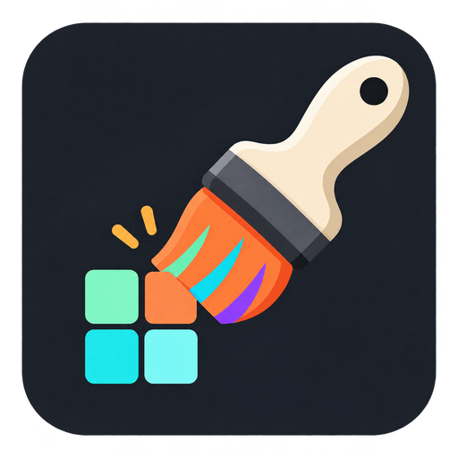
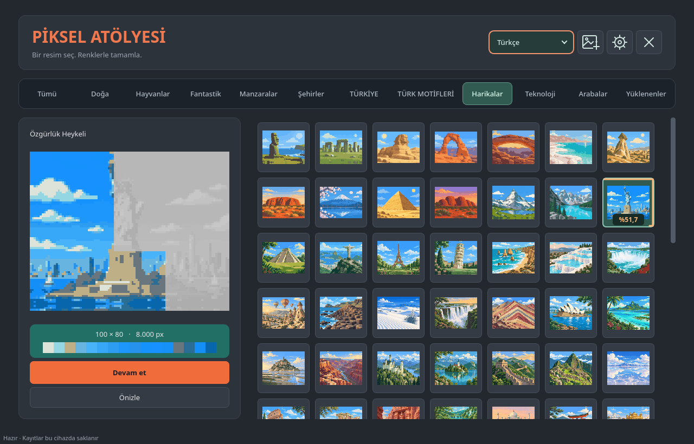
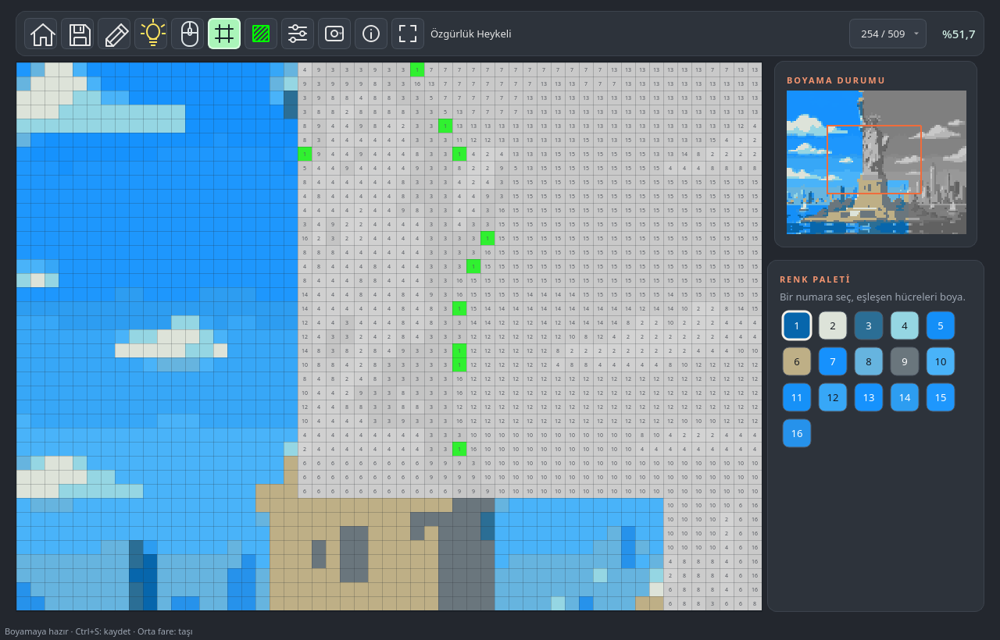
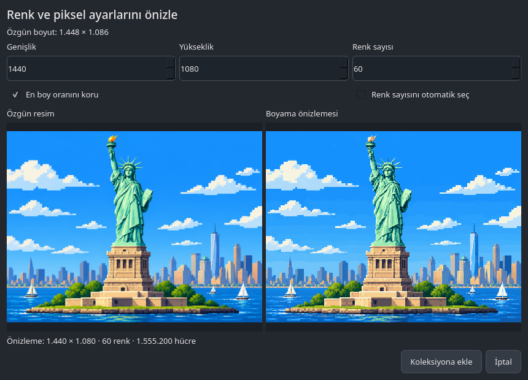
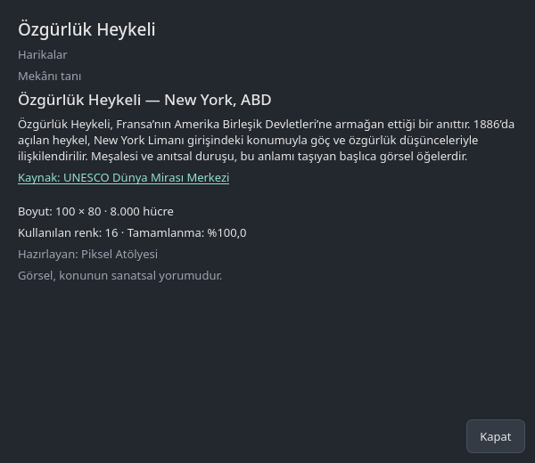
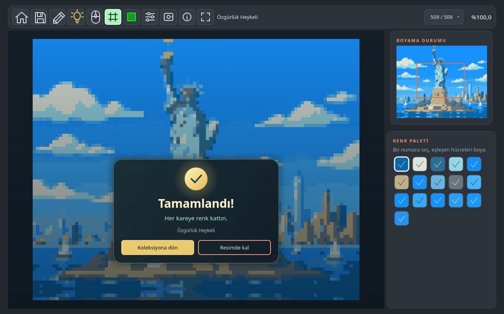

<div align="center">
  
  <h1>Piksel Atölyesi</h1>
  <p><strong>Bir resim seç. Renklerle tamamla.</strong></p>
  <p>900 resimle başlayabileceğin, kendi görsellerini de boyayabileceğin çevrimdışı masaüstü oyunu.</p>

  [](https://github.com/Teknoloji-Filozoflari/Pixel_Color_Game/releases/latest)
  [](https://github.com/Teknoloji-Filozoflari/Pixel_Color_Game/actions/workflows/python-package.yml)
  [](https://github.com/Teknoloji-Filozoflari/Pixel_Color_Game/actions/workflows/windows.yml)
  [](LICENSE)

  <p><a href="https://github.com/Teknoloji-Filozoflari/Pixel_Color_Game/releases/latest"><strong>Oyunu indir</strong></a> · <a href="#nasıl-oynanır">Nasıl oynanır?</a> · <a href="#kendi-resmini-boya">Kendi resmini boya</a> · <a href="CONTRIBUTING.md">Katkıda bulun</a></p>
</div>



Hesap açmadan, reklam veya telemetri olmadan oyna. Küçük bir sahneyi tek oturuşta tamamla ya da büyük bir resme günler boyunca dön. İlerlemen ve görünüm ayarların kendi bilgisayarında saklanır.

## İndir ve başla

**[GitHub Releases →](https://github.com/Teknoloji-Filozoflari/Pixel_Color_Game/releases/latest)** sayfasındaki **Assets** bölümünden sistemine uygun dosyayı seç:

| Sistem | İndirme seçeneği | Başlatma |
|---|---|---|
| **Windows 10 / 11 · x64** | **`Piksel-Atolyesi-<sürüm>-Setup-x64.exe`** | Yükleyiciyi aç, kurulumu tamamla ve Başlat menüsünden oyna. Python kurulumu gerekmez. |
| **Windows · taşınabilir** | `piksel-atolyesi-<sürüm>-windows-x64.zip` | ZIP'in tamamını çıkar, içindeki `Piksel-Atolyesi.exe` dosyasını aç. |
| **Linux · AppImage** | `Piksel-Atolyesi-<sürüm>-x86_64.AppImage` | Dosyaya çalıştırma izni verip aç. Ubuntu 22.04+ tabanı, glibc 2.35+. |
| **Debian 12 / 13 · amd64** | `piksel-atolyesi_<sürüm>-1_amd64.deb` | `sudo apt install ./indirdiğin-dosya.deb` |
| **Fedora 43 · x86_64** | `piksel-atolyesi-<sürüm>-1.fc43.x86_64.rpm` | `sudo dnf install ./indirdiğin-dosya.rpm` |
| **Linux · Snap** | `piksel-atolyesi_<sürüm>_amd64.snap` | `sudo snap install --dangerous ./indirdiğin-dosya.snap` |
| **Nix / NixOS** | [Flake ile kurulum](docs/LINUX_PACKAGES.md#nix--nixos) | `nix run github:Teknoloji-Filozoflari/Pixel_Color_Game` |

Windows EXE ve taşınabilir ZIP dağıtımı **0.17.0 ile eklenir**. Yeni sürümün dosyaları yayınlanana kadar son sürüm sayfasında yalnızca önceki sürümün paketleri bulunabilir. Windows'ta kaynak koddan çalıştırma seçeneği de aşağıdadır.

900 resim ve çalışma bağımlılıkları hazır masaüstü paketlerine dahildir. İlk indirme ve kurulumdan sonra oyun için internet gerekmez. Windows yükleyicisi kullanıcı hesabına kurulur; taşınabilir ZIP de kayıtlarını kullanıcı profilinde tutar. Güncelleme ve kaldırma boyama kayıtlarını silmez. Paketlerde geliştiricinin kişisel kayıtları bulunmaz.

Kurulum ayrıntıları: [Windows rehberi](docs/WINDOWS.md) · [Linux rehberi](docs/LINUX_PACKAGES.md). Yayınlardaki `SHA256SUMS` dosyası indirdiğin paketlerin bütünlüğünü kontrol etmek içindir.

## Seni neler bekliyor?

| | |
|---|---|
| **900 hazır resim, 10 kategori** | Doğa, Hayvanlar, Fantastik, Manzaralar, Şehirler, Türkiye, Türk Motifleri, Harikalar, Teknoloji ve Arabalar. |
| **7 zorluk seviyesi** | Çok Kolay'dan Uzman'a; kısa molalar için küçük resimler, uzun çalışmalar için ayrıntılı sahneler. |
| **Rahat boyama** | Sürükleyerek boya, bitişik alanı doldur, sağ tıkla renk seç, ipucuyla kalan hücreyi bul. |
| **Akıllı renk geçişi** | Bir renk bitince sıradaki tamamlanmamış renge geçilir. Benzer tonlar palette dağıtılarak gösterilir. |
| **Kaldığın yerden devam** | Otomatik kayıt; resimle birlikte yakınlaştırma ve bakış konumunu hatırlama. |
| **Sana uygun görünüm** | Numara boyutu, ızgara, vurgu rengi ve yoğunluğu; mini harita ve odak modu. |
| **Kendi resimlerin** | Yan yana önizleme, algısal renk dönüşümü, 2–256 renk, tekli veya toplu içe aktarma. |
| **Boyama kaydı** | Boyarken kaydı başlat, duraklat, sürdür ve ilerleyişini GIF olarak kaydet. |
| **Mekânları tanı** | Türkiye'deki 81 ve Harikalar'daki 91 görsel için kaynak bağlantılı, çevrimdışı Türkçe bilgi kartları. |
| **Bitirdiğinde paylaş** | Konfetili tamamlanma kutlaması ve tamamlanan resmi temiz PNG olarak dışa aktarma. |

Arayüz Türkçe, İngilizce, Almanca, Fransızca ve İspanyolca seçenekleri sunar. Yeni mekân tanıtımları Türkçedir.

## Nasıl oynanır?

1. Koleksiyondan bir resim seç ve **Başla** / **Devam et** düğmesine bas.
2. Paletteki bir rengi seç. Yakınlaştığında görünen aynı numaralı hücreleri boya.
3. Renk tamamlanınca oyun sıradaki eksik renge geçer; boyamayı yeni bir tıklamayla sürdür.
4. İstediğin zaman kaydet ve koleksiyona dön. Resim tamamlanınca aynı kutlama kartından koleksiyona dönebilir veya resimde kalabilirsin.



| Kontrol | İşlev |
|---|---|
| Sol tık / sürükle | Seçili renge ait hücreleri boya |
| Sağ tık | Hücrenin istediği rengi seç |
| Fare tekerleği | Yakınlaştır / uzaklaştır |
| Orta fare / sürükle | Resmi taşı |
| Yön tuşları | Görünümü her basışta **bir hücre** kaydır |
| `F` | Resmi ekrana sığdır |
| `G` | Izgarayı aç / kapat |
| `M` | Mini haritayı aç / kapat |
| `Ctrl+S` | İlerlemeyi kaydet |

Yanlış renkle tıklanan hücre değişmez. Üst çubuktaki görünüm düğmesi numara ve ızgara ayarlarını açar; ⓘ düğmesi resim hakkındaki bilgileri gösterir. Fare simgesi üzerinden ayrıntılı kontrolleri inceleyebilirsin.

## Kendi resmini boya

Ana ekrandaki **resim ekle** simgesinden bir dosya, birden çok dosya veya bir klasör seç. PNG, JPG/JPEG, WEBP ve `.pcolor` desteklenir; özgün dosyaların değiştirilmez.



- Genişliği, yüksekliği ve renk sayısını önizleyerek ayarla. En boy oranını koruyabilir, renk sayısını otomatik seçebilir veya **2–256** arasında belirleyebilirsin.
- Algısal dönüşüm, sınırlı palette küçük ama belirgin renkleri de korumayı hedefler. Az renkle dönüşüm bazı tonları birleştirir; her görselde özgün renklerin tamamı korunamaz.
- Boyama boyutu en fazla **1920 × 1080** olabilir. Daha küçük boyutlar, tamamlaması daha kolay resimler oluşturur.
- Toplu eklemede ortak boyut ve renk ayarları uygulanır. `.pcolor` dosyalarının hazır paleti korunur.

<details>
<summary><strong>Bilgi kitapçığı ve tamamlanma ekranını gör</strong></summary>

| Mekânı tanı | Tamamlandığında |
|---|---|
|  |  |

GIF kaydı yalnızca başlattığın andan itibaren, resim açıkken tutulur. Koleksiyona dönmeden önce GIF'i kaydet. Tamamlanan resimleri koleksiyondan PNG olarak indirebilirsin.

</details>

## Kaynak koddan çalıştır

**Python 3.13 veya üzeri** gerekir. Kaynak ZIP'ini aç veya depoyu klonla; `pyproject.toml` bulunan klasörde çalıştır.

**Linux:**

```bash
python3 -m venv .venv
source .venv/bin/activate
python -m pip install .
./start.sh
```

**Windows · PowerShell:**

```powershell
py -3.13 -m venv .venv
.\.venv\Scripts\python.exe -m pip install .
.\.venv\Scripts\python.exe run.py
```

Farklı bir kayıt klasörüyle denemek için `python run.py --data-dir ./local-data` kullan. Normal kayıt klasörü Windows'ta `%LOCALAPPDATA%\PixelColoring\PikselAtolyesi`, Linux'ta `${XDG_DATA_HOME:-~/.local/share}/PixelColoring/PikselAtolyesi` altındadır. Snap ayrı kayıt alanı kullanır. Yedek almadan bu klasörleri silme.

## Geliştirme ve katkı

```bash
python -m pip install -e '.[dev]'
python -m ruff check src tests run.py packaging/build_bundle.py packaging/build_release.py packaging/build_windows.py packaging/windows/smoke_test.py packaging/verify_release_runs.py
python -m pytest -q
```

[Katkı rehberi](CONTRIBUTING.md) · [Mimari](docs/ARCHITECTURE.md) · [Koleksiyon yapısı](KOLEKSIYON.md) · [Windows paketleme](docs/WINDOWS.md) · [Yayın süreci](docs/GITHUB_SETUP.md) · [0.17.0 değişiklikleri](docs/release-notes/v0.17.0.md)

Hata bildirirken işletim sistemini, oyun sürümünü ve sorunu tekrar oluşturma adımlarını [Issues](https://github.com/Teknoloji-Filozoflari/Pixel_Color_Game/issues) üzerinden paylaşabilirsin. Kişisel boyama veritabanını paylaşman gerekmez.

## Lisans ve içerik

Kaynak kodu ve belgeler **[GNU GPL 3.0 veya sonraki sürümleri](LICENSE)** ile sunulur. Koleksiyon görselleri yapay zekâ desteğiyle üretilip oyun verisine dönüştürülmüştür; kapsam ve üçüncü taraf hakları [ASSETS_LICENSE.md](ASSETS_LICENSE.md) ile [görsel hakları notunda](TELIF-VE-YAYIN-NOTU.md) açıklanır. Bağımlılık ve font bildirimleri [THIRD_PARTY.md](THIRD_PARTY.md) ve [LICENSES](LICENSES/) içindedir.
