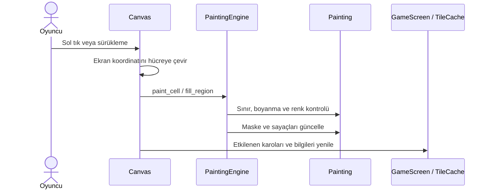

# Mimari ve veri akışları

[README'ye dön](../README.md)

Bu belge v0.17.0 kaynak kodunu anlatır. Uygulama, Qt Widgets arayüzü ile Qt'den bağımsız oyun çekirdeğini ayırır. Sunucu, kullanıcı hesabı veya çevrim içi oyun servisi yoktur.

## Katmanlar ve sorumluluklar

| Modül | Sorumluluk | Başlıca dosyalar |
|---|---|---|
| Başlangıç | CLI seçenekleri, QApplication, veri dizini, günlükleme | `app.py` |
| Çekirdek | Doğru renk kontrolü, boyama maskesi, sayaçlar, oturum | `core/painting.py`, `paint_engine.py`, `game_session.py` |
| Çizim | Kamera dönüşümleri, görünür karolar, imleç, önizleme | `rendering/canvas.py`, `camera.py`, `tile_cache.py`, `progress_preview.py` |
| Arayüz | Ekran geçişleri, araçlar, koleksiyon, palet, ayarlar | `ui/main_window.py`, `game.py`, `collection_browser.py`, `widgets.py` |
| İçe aktarma | Algısal palet seçimi, görsel ve seviye okuma/yazma | `importer/image_importer.py`, `quantization.py`, `level_writer.py` |
| Kalıcılık | SQLite, maske paketleme, sıralı kayıt | `persistence/database.py`, `save_manager.py` |
| Koleksiyon | Hazır seviyelerin kurulumu, sürüm dönüşümleri | `services/samples.py`, `library.py`, `bundle_update.py` |

## Başlangıç

`run.py`, `pixel_coloring.app.main()` giriş noktasını çağırır. Başlangıçta veri dizini ve `paintings/` oluşturulur, SQLite açılır, hazır seviyeler kurulur ve `MainWindow` gösterilir. `--data-dir` varsayılan Qt veri yolunu değiştirir; `--smoke-test` kısa bir açılış/kapanış kontrolü, `--debug` tanı görünümü sağlar.

## Resmin bellek modeli

`Painting` tek resmin verisini ve ilerlemesini tutar:

| Alan | Biçim | Amaç |
|---|---|---|
| `palette` | `N × 3`, `uint8` | RGB renk tablosu |
| `target_map` | `H × W`, `uint8` veya `uint16` | Hücrelerin sıfır tabanlı palet indeksleri |
| `painted_mask` | `H × W`, `bool` | Boyanan hücreler |
| `totals` | Renk başına sayaç | Her renge ait toplam hücre |
| `counts` | Renk başına sayaç | Her renge ait boyanan hücre |

Hedef ve palet kopyalanıp salt okunur yapılır; maske ve sayaçlar boyama sırasında değişir. 255'e kadar renk için hedef harita `uint8`, daha büyük paletlerde `uint16` kullanır. Kurucu boyut, RGB aralığı ve renk indekslerini doğrular.

`GameSession`, seçili renk, kamera görünümü ve değişiklik/kayıt revizyonlarını yönetir. Çekirdekte komut geçmişi desteği bulunsa da oyun oturumu `record_history=False` kullanır; arayüzde geri al/ileri al yoktur. Süre özelliği sıfır döner.

## Boyama akışı



Tekli boyama yanlış renk, sınır dışı hücre ve önceden boyanmış hücreleri ayırır. Toplu boyama satır aralıkları üzerinden ilerleyen bir doldurma algoritmasıdır: yalnızca aynı renkli, dört yönden bağlı, boyanmamış hücreleri kapsar. Çapraz komşuluk bağlantı sayılmaz. Tuval, sürükleme noktaları arasındaki hücreleri de işler.

## Kamera ve çizim

Her hücre için ayrı Qt nesnesi oluşturulmaz. Tek `Canvas`, `Camera` ile görünür hücre aralığını hesaplar ve `TileCache` üzerinden `QImage` karolarını çizer. Karolar 256 × 256 hücredir; önbellek varsayılan 64 MiB sınırla LRU düzeninde tutulur. Boyanan hücreler ilgili karoları geçersiz kılar; renk/vurgu değişiklikleri önbelleği yeniler.

Yakınlaştırmada kamera resim sınırlarına kısıtlanır. Hücre ölçeğinde görünür alan tam hücrelere oturtulur; taşıma sırasında yarım hücre kesilmeleri önlenir. Mini harita boyanan alanları renkli, kalan alanları gri gösterir; bakış çerçevesi görünür alanı temsil eder. İpucu etkin olduğunda kalan hücreler kırmızı vurgulanır.

## İçe aktarma ve dışa aktarma

Raster akışı: EXIF yönüne göre boyut kontrolü → yönü uygulama → şeffaflığı beyaza birleştirme → gerekiyorsa LANCZOS boyutlandırma → Oklab uzayında algısal palet seçimi → tam boyutta en yakın palet rengine eşleme → `Painting` → `.pcolor`.

`quantization.py`, kaynak zaten renk bütçesine sığıyorsa RGB renklerini kayıpsız korur.
Diğer görseller için tüm piksellerin katkıda bulunduğu 5 bit/kanal RGB histogramı
oluşturur. Histogram ortalamaları sRGB gama dönüşümünden sonra Oklab'a taşınır.
Renk uzaklığı ve yumuşatılmış kullanım sıklığıyla başlangıç renkleri seçilir;
20 adımla sınırlı ağırlıklı kümeleme paleti iyileştirir. Küçük, farklı renkli
alanların geniş zemin tonları içinde kaybolmasını azaltmak için sıklıklar
`count ** 0.85` ağırlığını kullanır. Griye yakın görsellerde histogram kutuları
istenen paletten azsa gerçek RGB renkleriyle çalışılır; ince tonlar 32 kutuya
sıkıştırılmaz. Son eşleme her özgün pikselin algısal uzaklığıyla yapılır.
Komşu piksellere hata dağıtılmaz (dithering yoktur). Geçici uzaklık dizileri
4096 piksellik parçalarla sınırlıdır; yeni bağımlılık gerektirmez. Algoritma
rastgelelik kullanmaz. Renk sayısı sınırı, mevcut kayıtlar ve `.pcolor` dosyaları
değişmez; tekli önizleme ve toplu ekleme aynı dönüştürücüyü kullanır.

Renk uzayı formülleri: [Björn Ottosson, Oklab](https://bottosson.github.io/posts/oklab/).
Sabit renk sayısında kalite karşılaştırması ve sınırlar:
[renk dönüşümü incelemesi](RENK_DONUSUMU_2026_10_18.md).

Raster görsel seçildiğinde `ImportPreviewDialog` özgün ve dönüştürülmüş resmi yan yana gösterir. Kullanıcı genişliği, yüksekliği ve renk sayısını ayarlayabilir; en boy oranı kilidi ve otomatik renk sayısı seçenekleri vardır. Renk sayısı elle 2–256 arasında seçilebilir. Tek işçili arka plan dönüştürücü ve istek revizyonu denetimi, güncel olmayan önizlemenin onaylanmasını engeller. Onaylanan `Painting` tekrar dönüştürülmeden kaydedilir; iptal diske seviye yazmaz.

Son boyama boyutu en fazla 1920 × 1080'dir. Büyük raster kaynaklar önizlemede küçültülebilir. `.pcolor` dosyaları mevcut paletleriyle doğrudan eklenir; bunlara arayüz boyut sınırı uygulanır. Düşük seviyeli `read_level()` kendi dosya doğrulamalarını uygular.

Tamamlanan resim dışa aktarılırken kayıtlar tamamlanır, ilerleme kontrol edilir ve `palette[target_map]` RGB görüntüsü `QSaveFile` üzerinden PNG olarak yazılır. Çıktıda numara, ızgara ve araç çubuğu yoktur.

## Yeni oyun araçları

`AppearanceMenu` mevcut ayar sözlüğünü günceller; tuval numara ölçeğini ve ızgara
kalınlığını çizim sırasında uygular. Ayarlar mevcut SQLite ayar mekanizmasıyla
kalıcılaşır. `CompletionOverlay`, yalnızca yeni bitirilen resimde 3,6 saniyelik
kutlama gösterir: bütün resmin görünümü, iki yandan yükselen 160 konfeti,
altın rozet, çevrilmiş tamamlanma yazısı ve resmin başlığı. Piksel resimlerde
keskin çizim korunur. Kutlama sırasında fare olayları engellenmez.
Kameranın yakınlaştırması ve kayıtlı görünümü değiştirilmez. Animasyon bitince
aynı kartta “Koleksiyona dön” ve “Resimde kal” düğmeleri belirir; ikinci bir
`QMessageBox` açılmaz. Animasyon kapalıysa aynı kart doğrudan seçenekleriyle
gösterilir. Koleksiyona dönüş mevcut kayıt ve sayfa geçişi akışını kullanır;
resimde kalmak kartı kapatıp tuvale odağı geri verir. Seçenekler küçük alanda
ve uzun çevirilerde dikey sıralanır. Sayfadan ayrılma ve kapanma animasyonu ve
kayıt zamanlayıcısını durdurur. Tamamlanma kartı aynı resim için çoğaltılmaz.

`Timelapse` kayıt başlatılana kadar kare oluşturmaz. Gerçek boyama ilerlemesi
`ProgressPreview` ile en fazla 320 × 240 boyutunda örneklenir. Varsayılan sınır
180 karedir; sınıra gelindiğinde aradaki kareler seyreltilir. İlk durum ve
duraklatmadaki son durum korunur. `RecordingMenu` 300 ms aralığında yalnızca
boyama değiştiyse örnek ister. Kareler açık resme aittir, kalıcı boyama kaydına
yazılmaz. GIF dönüştürme mevcut arka plan işçisinde yapılır; geçici dosya tamamen
yazıldıktan sonra hedef dosya atomik olarak değiştirilir.

`ArtworkInfoDialog` kişisel metadata'yı düz metin olarak gösterir. Kaynaklı
bilgiler yalnızca `resources/artwork_facts.json` içindeki açık resim kimliği
eşleşmelerinden gelir; başlık veya resim benzerliğinden çıkarılmaz. Bilgi metni
çevrimdışı okunur, yalnızca kaynak bağlantısına tıklamak tarayıcı açar. Türkiye
kategorisindeki 81 ve Harikalar kategorisindeki 91 görselin her biri için ayrı
mekân adı, üç cümlelik Türkçe tanıtım, yayıncı adı, doğrudan kaynak bağlantısı ve
kontrol tarihi tutulur. `FACTS_BY_PAINTING` kimlik üzerinden erişim sağlar.
Tanıtım teknik bilgilerden önce gösterilir. Önceden bulunan yabancı dildeki
mekân açıklamaları korunmuş; İzmir, İstanbul ve Şanlıurfa kartlarında yanlış
mekânı anlatan eski metinler bütün mevcut dillerde düzeltilmiştir. Yeni eklenen
diğer tanıtımlar Türkçedir; çeviri yoksa standart `tr()` kaynak metin davranışı
kullanılır. Diğer kategoriler mevcut motif açıklaması veya teknik bilgileri
kullanmayı sürdürür.

Toplu ekleme `BatchImportDialog` ortak ayarları aldıktan sonra `import_batch`
ile dosyaları sırayla işler. İptal işareti dosyalar arasında kontrol edilir.
Sonuçlar ve hatalar ayrı listelerde döner; ilerleme kuyruğundan Qt ana iş
parçacığında okunur. Veritabanına kaydı başarısız olan yeni seviye dosyası
silinir; kaynak dosyalar değiştirilmez.

## `.pcolor` dosyası

Bir ZIP arşividir:

```text
resim.pcolor
├── metadata.json   # version, id, title, category, author, width, height
├── palette.json    # RGB üçlüleri
├── target.npy      # H × W renk indeksleri
└── preview.webp    # Koleksiyon küçük resmi
```

Dosya biçimi sürümü `1`'dir. Okuyucu arşiv üyeleri için açılmış boyut limitleri uygular, NumPy verisini `allow_pickle=False` ile yükler, metadata boyutlarını resimle karşılaştırır. Yazıcı geçici dosyayı `os.replace` ile hedefe taşır. `.pcolor` boyama ilerlemesini içermez; bu veri SQLite'tadır.

`resources/paintings/catalog.json` kategori, zorluk, sıra, boyut ve renk sayısı bilgilerini taşır. Kimlikler kayıt eşleştirmesinin temelidir; mevcut bir görseli değiştirirken kimliği rastgele değiştirmek ilerlemeyi başka bir seviyeden ayırır.

## Kayıt ve güncelleme

`SaveManager`, arayüz iş parçacığında maskeyi `numpy.packbits` ile paketleyip bir anlık görüntü oluşturur. Kamera görünümü de kopyalanır; yakınlaştırma, mantıksal merkez ve resim boyutları `view_states` tablosunda maske ile aynı işlemde kaydedilir. Önceki kayıtlar bu tablo olmadan da açılır; tablo kendiliğinden oluşturulur. Görünüm ilk tuval boyutlandırmasından sonra yüklenir, farklı pencere boyutlarında merkez korunur ve resim sınırlarına kısıtlanır. Resmin boyutu değişmişse veya görünüm bozuksa normal sığdırma kullanılır. “Baştan başla” görünümü de sıfırlar.

Tek işçili `ThreadPoolExecutor`, SQLite yazımlarını sırayla gerçekleştirir. `flush()` bekleyen işlemleri tamamlar ve hataları iletir; başarısız kayıt sessizce başarılı sayılmaz.

SQLite'ta resim metadata'sı, ilerleme ve ayarlar bulunur. WAL modu kullanılır. Süre ve toplu istatistik verileri güncel sürümde tutulmaz; eski `statistics` ve `achievements` tabloları uyumluluk için kalır fakat temizlenir.

Hazır seviye güncellemelerinde `bundle_update.py` mevcut dosyayı ve kaydı değerlendirir. Gerekli boyut dönüşümlerinde maske yeni ızgaraya aktarılır; önceki resim/kayıt `paintings/backups/` altında yedeklenir. Sadece yeni seviye eklenen v0.14.0 değişikliğinde eski 180 dosya değişmedi.

## Genişletme noktaları

- Yeni araç: `ui/game.py` ve `rendering/canvas.py`; oyun kuralları gerekiyorsa `core/paint_engine.py`.
- Yeni seviye: doğrulanmış `.pcolor` ve katalog girdisi; piksel/renk sınırlarını kategori testleriyle kontrol et.
- Yeni kalıcılık alanı: SQLite şemasını ve eski kayıt dönüşümünü birlikte ele al.
- Yeni giriş biçimi: `importer/` altında dönüştür; Qt widget işlemlerini ana iş parçacığında tut.

Bu tasarımın performans hedefleri donanıma bağlıdır; belirli FPS veya bütün platformlarda eşit davranış garantisi verilmez.
